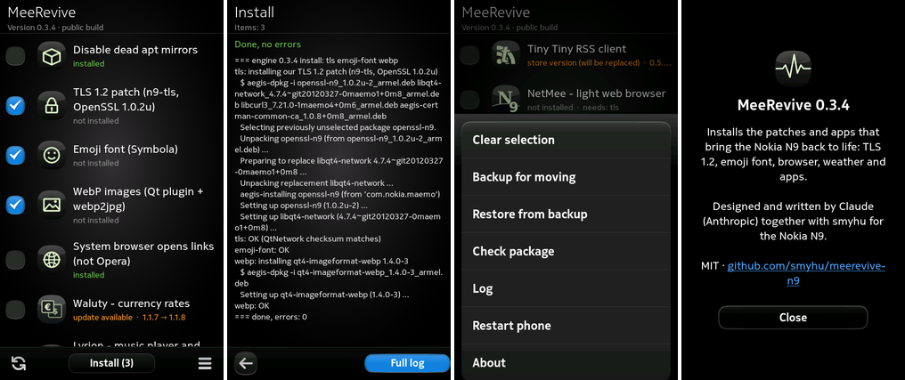

# MeeRevive for Nokia N9

One app that brings the Nokia N9 (MeeGo Harmattan PR1.3) back to life in 2026: it installs,
updates and removes the community fixes and the apps written for the N9, from one list, without
SSH or a terminal.



- One list of components with their state: installed, not installed, update available,
  store version (replaced by our fork), incomplete. Tick what you want and tap **Install**.
  Hold an entry to install or remove just that one.
- The installation log is shown live. **Full log** adds the complete output of `aegis-dpkg`,
  as you would see it over SSH.
- After the TLS patch the app asks whether to restart the phone.
- **Backup for moving** saves data (for example the Feeds app subscriptions) to
  `MyDocs/MeeRevive`; **Restore from backup** puts it back on another phone.
- Languages: English, Polish. Dark UI for the AMOLED screen.

Designed and written by Claude (Anthropic) together with smyhu.

## What it installs

| Component | What it does |
|---|---|
| Disable dead apt mirrors | comments out repositories that no longer exist, so the package manager stops failing |
| TLS 1.2 patch | [n9-tls](https://github.com/smyhu/n9-tls): OpenSSL 1.0.2u for Qt, curl and the certificate store, so HTTPS sites work again |
| Emoji font | Symbola, so emoji show up in messages and web pages |
| WebP images | Qt image plugin + `webp2jpg` |
| System browser opens links | links from other apps open in the built-in browser instead of the discontinued Opera Mobile |
| Apps | [Waluty](https://github.com/smyhu/waluty-n9), [Lyrion](https://github.com/smyhu/lyrion-n9), [MeeTranslate](https://github.com/smyhu/meetranslate-n9), [HAL 2027](https://github.com/smyhu/hal2027-n9), [GPS Info](https://github.com/smyhu/gpsinfo-n9), [Tiny Tiny RSS](https://github.com/smyhu/ttrss-n9), [NetMee](https://github.com/smyhu/netmee-n9), [AuthMee](https://github.com/smyhu/authmee-n9), [modRana](https://github.com/smyhu/modrana-n9) |
| More apps | [FeedMee](https://github.com/smyhu/feedmee-n9) (news with service icons in the Events view; set your own bridge address), [MeeConf](https://github.com/smyhu/meeconf-n9) (bulk e-mail account setup, manual or from CSV), [MeeVPN](https://github.com/smyhu/meevpn-n9) with [openvpn-n9](https://github.com/smyhu/openvpn-n9) (OpenVPN 2.5.11 client), talk.maemo.org forum client (forum-qml 0.2.1 by Anand Bibek, fixed for HTTPS; patch in [third-party/forum-qml](third-party/forum-qml)) |
| MeeCast | weather app 1.1.33, its Events view applet, and an Open-Meteo weather source (the original providers are gone) |
| Feeds app manager | `kanaly.sh`: list, add, remove, back up and restore subscriptions of the built-in Feeds app |

Licences of every component are in [tools/LICENSES.txt](tools/LICENSES.txt).

## Install

You need a phone with developer mode and `aegis-dpkg` (from QTweak / hack-installer).
Copy `dist/meerevive-n9_0.3.13-public_armel.deb` to the phone (for example to
`/home/developer`, because `/tmp` is only 4 MB) and install it as root:

```
aegis-dpkg -i /home/developer/meerevive-n9_0.3.13-public_armel.deb
```

Then start **MeeRevive** from its icon. The package is about 37 MB because it carries every
component, so nothing has to be downloaded on the phone.

## How it works

| Path on the phone | What |
|---|---|
| `/opt/meerevive-n9/app/` | the app (Python 2.6 + PySide + QML, Qt Components) |
| `/opt/meerevive-n9/engine.sh` | the engine: a busybox shell script that does the work (`list`, `check`, `install`, `remove`, `tls-finish`, `backup`, `restore`, `reboot`, `log`) |
| `/opt/meerevive-n9/bin/meerevive-root` | small root helper (see below) |
| `/opt/meerevive-n9/payload/` | the component packages and files, checked against `md5sums.txt` |
| `/var/lib/meerevive-n9/`, `/var/log/meerevive-n9.log` | engine state and log |

Installing packages needs root. The package's Aegis manifest (`packaging/_aegis`, with
`digsigsums`) gives only `meerevive-root` the credentials `CAP::setuid` and `CAP::setgid`.
The helper is a static ARM program without libc. It accepts only the engine's own commands and
component names made of `a-z`, `0-9` and `-`, then runs `/bin/sh /opt/meerevive-n9/engine.sh`
as root with a fixed, clean environment. Anything else is refused.

The engine also works on its own over SSH, as root:

```
sh /opt/meerevive-n9/engine.sh list
```

## Building

| Path | What |
|---|---|
| `app/` | `main.py` and `qml/` (texts in `strings.js`) |
| `engine/` | `engine.sh` and `lib/` |
| `helper/` | `meerevive-root.c`, built with `gcc-arm-linux-gnueabihf` (`helper/build.sh`) |
| `tools/build.sh` | assembles the payload and `components.list` (`public` build = only components we may redistribute) |
| `tools/component-icons.py` | list icons for entries without an app icon (`art/components/`) |
| `packaging/build-deb.sh` | builds the `.deb` (app + helper + engine + payload, `_aegis`, `digsigsums`) |

```
sh packaging/build-deb.sh public dist
```

`tools/build.sh` takes the component packages from the folder in `MEEREVIVE_SRC`; they are the
released `.deb` files of the projects listed above.

## Licence

MIT (see [LICENSE](LICENSE)) for the app, engine, helper and scripts. The bundled components
keep their own licences, listed in [tools/LICENSES.txt](tools/LICENSES.txt).
